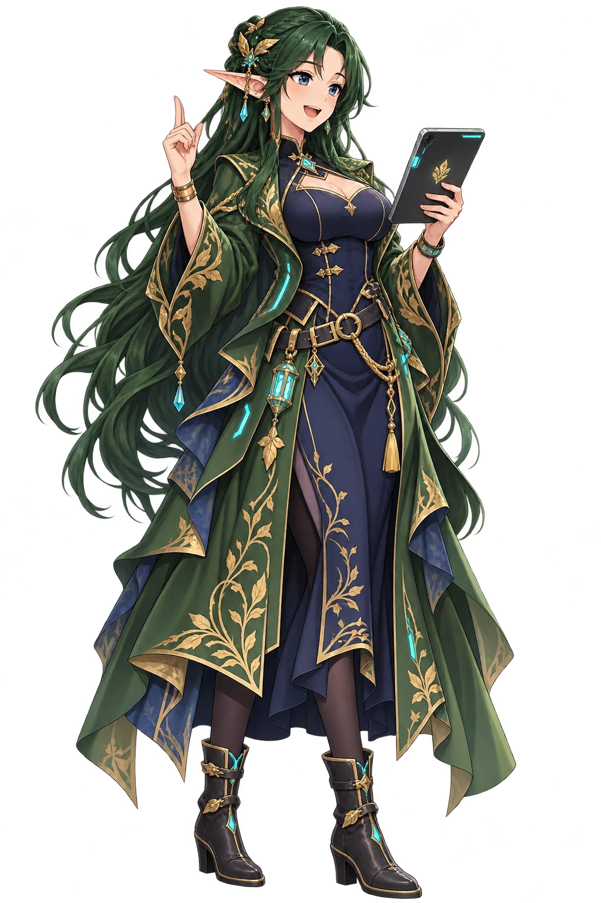

# Knowledge Forge AI

**Curiosity, made useful.**

Open tools for understanding code, shaping systems, and making thoughtful things.
Knowledge Forge AI builds inspectable software for agent engineering, repository
intelligence, visual systems, distribution and declarative workstations.

Meet **Rei Ai**: a long-lived Sylvan elf who discovered modern technology and
immediately wanted to understand it. Eccentric, intelligent and cheerfully curious,
she brings a woodland perspective to the forge.

**[Website](https://www.knowledge-forge.ai/)** ·
**[Release journal](https://www.knowledge-forge.ai/journal/)** ·
**[Community discussions](https://github.com/orgs/Knowledge-Forge-AI/discussions)**

## Agent engineering and repository understanding

| Project | Start here |
| --- | --- |
| **[Agentic Praxis Grimoire](https://www.knowledge-forge.ai/agentic-praxis-grimoire/)** | Provider-neutral tools and skills for bounded agent engineering. Meet Shiori, APGR’s grimoire-obsessed high elf. [Source](https://github.com/Knowledge-Forge-AI/agentic-praxis-grimoire). |
| **[RepoMap → Common Lore Index (CLOE)](https://github.com/Knowledge-Forge-AI/repo-map)** | Deterministic, evidence-linked knowledge graphs for repositories. The rebrand is in progress; current repository and CLI identities remain RepoMap. |

DINAS was the original inspiration for RepoMap: understanding a complex workstation
needed a map of how its code, configuration and tools connect. [Read the origin
story](https://www.knowledge-forge.ai/journal/dinas-2026-10-22/).

## Theme Forge

Six independently versioned projects connect visual intent to assets, themes and
applications. Orihime, the celestial weaver, represents the family.

| Project | Purpose |
| --- | --- |
| [Stellar Burst](https://tfsb.knowledge-forge.ai/) | Declarative SVG assets and their lifecycle. |
| [Stellar Loom](https://tfsl.knowledge-forge.ai/) | Theme generation for Astro Starlight. |
| [Solar Sail](https://tfss.knowledge-forge.ai/) | Theme generation for Tailwind v4 and shadcn/ui. |
| [Nebular Fusion](https://tfnf.knowledge-forge.ai/) | A desktop workbench connecting the engines and paired visual systems. |
| [Starlight Theme Terminal Nova](https://sttn.knowledge-forge.ai/) | A Starlight theme with distinct appearance families. |
| [shadcn Theme Terminal Nova](https://cttn.knowledge-forge.ai/) | Terminal Nova themes for Tailwind/shadcn applications. |

## Workstations and disposable-environment foundations

- **[DINAS Core](https://github.com/Knowledge-Forge-AI/darwin-is-not-a-snowflake)**
  develops modular nix-darwin workstation machinery. Its public source preview
  is complemented by [Composition](https://github.com/Knowledge-Forge-AI/composition_dinas)
  and [Browser UX](https://github.com/Knowledge-Forge-AI/browser-ux_dinas) previews.
  Some composition adapters still require authorized access.
- **[Ephemeral Snowflake Artificer](https://github.com/Knowledge-Forge-AI/ephemeral-snowflake-artificer)**
  is an early VM image-contract and validation foundation. Qualified reusable
  images and operational integration are separate development work.

## Distribution, with Hikari on watch

- **[Release Starport 9](https://rs9.knowledge-forge.ai/)** connects authoritative
  upstream releases to downstream packaging and qualification.
- **[Theme Forge Packages](https://tf.rs9.knowledge-forge.ai/)** serves the signed
  APT, DNF and pacman repositories for both Linux architectures, including pacman
  AArch64. Nix has its own channel references; AUR publication remains deferred.
- **[Knowledge Forge AI Homebrew tap](https://brew.rs9.knowledge-forge.ai/)** is the
  organization-wide tap. Its current formulas cover APGR and four Theme Forge
  products. Formula source defines versions and installation behavior; the tap
  README distinguishes declared targets from completed platform qualification.

Hikari is RS9’s admiral. She also represents the Homebrew tap’s shared
distribution role, and joins Orihime on the Packages page.

## Build, ask, contribute

Use [Discussions](https://github.com/orgs/Knowledge-Forge-AI/discussions) for
questions, ideas, design feedback and showcases. Use the relevant repository’s
issue tracker for reproducible bugs and concrete work. Include the project,
version and installation route when reporting an experience. Follow our
[Code of Conduct](https://github.com/Knowledge-Forge-AI/.github/blob/main/CODE_OF_CONDUCT.md).

Public work spans released tools, early pilots and source previews. Each project’s
README, release records and platform qualification remain authoritative. A planned
integration does not establish a shipped feature or an available package.

## Licensing and contributions

Repositories generally use **AGPL-3.0-or-later**, with separate commercial terms
where offered. AGPL permits commercial use subject to its terms. Each repository’s
license and third-party notices control; original mascot/brand artwork has its
own explicit terms and is not implicitly covered by a software license.

Contributors retain copyright and grant the steward the sublicensing/relicensing
rights in the applicable CLA. Read the organization defaults for
[contributing](https://github.com/Knowledge-Forge-AI/.github/blob/main/CONTRIBUTING.md)
and [CLA](https://github.com/Knowledge-Forge-AI/.github/blob/main/CLA.md); repository-local
terms take precedence. An explicit CLA acknowledgment is required where specified;
a Signed-off-by line does not replace it.

Steward: **Samuel Leighton Lair**. Commercial and contribution contact:
**sam.lair@knowledge-forge.ai**.
